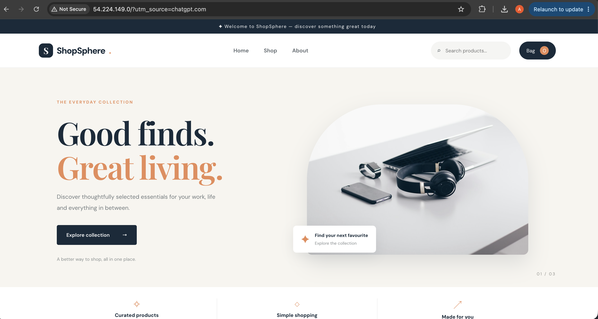
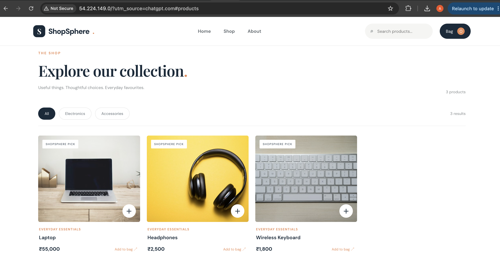
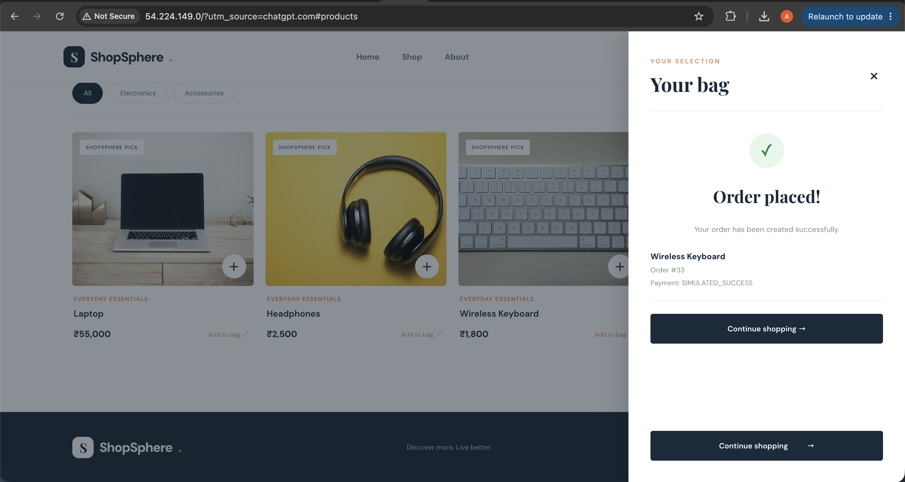
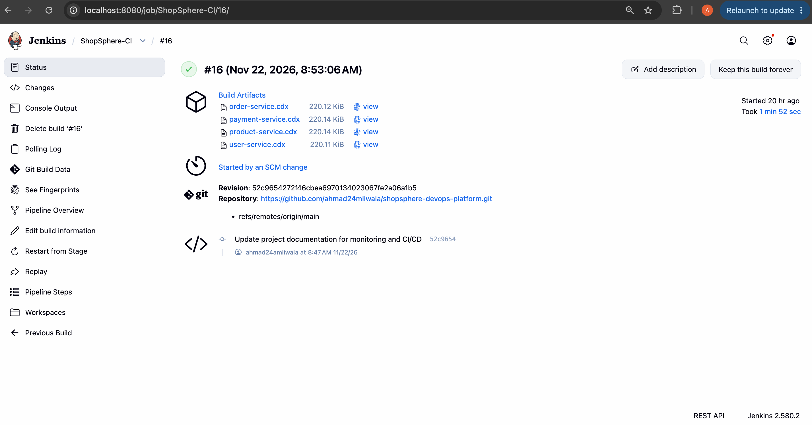
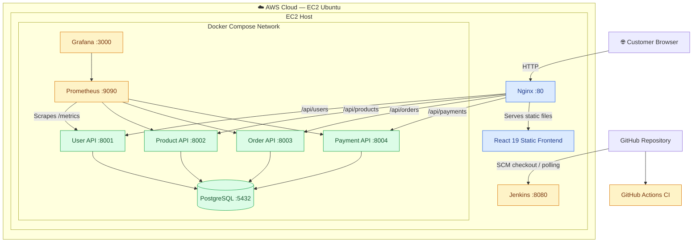
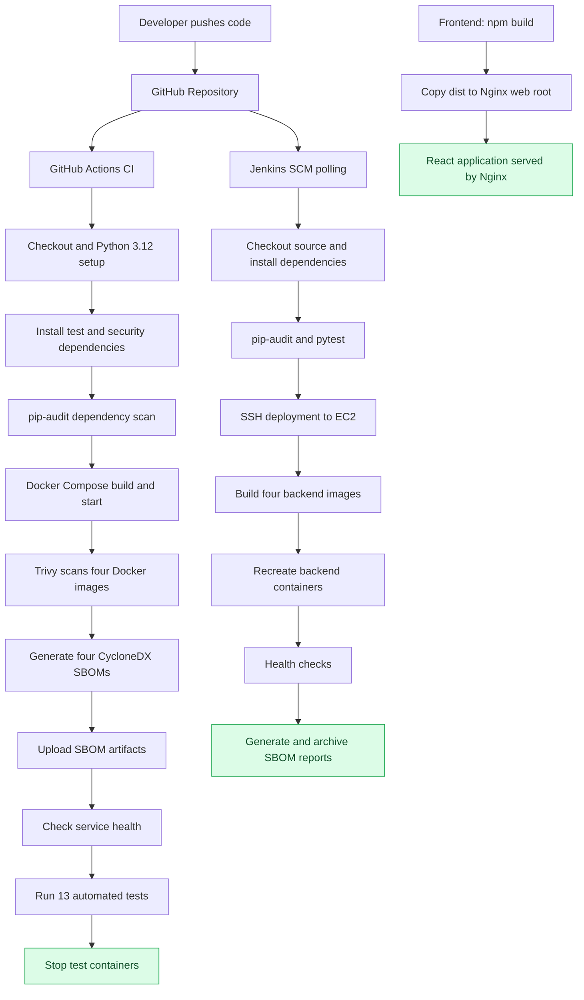
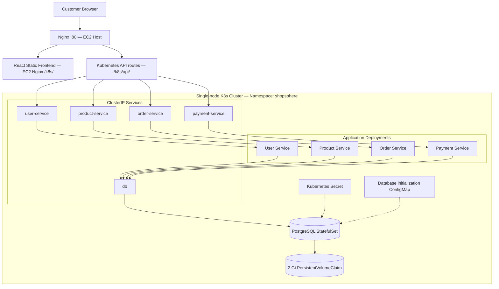

# ShopSphere — DevOps Microservices Platform

A hands-on DevOps portfolio project demonstrating a microservices-based e-commerce backend, containerization, automated testing, CI/CD, infrastructure management, deployment, metrics, and structured logging.

## 1. Project Overview

ShopSphere is a portfolio e-commerce platform with a React frontend, four independent FastAPI microservices, and PostgreSQL.

The platform runs on AWS EC2 Ubuntu and demonstrates two deployment environments: Docker Compose and a single-node K3s Kubernetes cluster managed with Helm. Each environment has its own application services and PostgreSQL database. Nginx serves the original React frontend at `/` and a separately built Kubernetes frontend at `/k8s/`, routing API requests to the corresponding backend.

### Key Features

- React 19 frontend with product browsing, search, category filters, cart, checkout, and order confirmation.
- Four independent FastAPI microservices.
- PostgreSQL relational database.
- Docker and Docker Compose containerization.
- Automated API and integration testing using pytest.
- GitHub Actions continuous integration.
- Jenkins CI/CD and automated deployment.
- Terraform-based read-only AWS infrastructure inspection.
- Ansible server configuration and auditing.
- Prometheus-compatible application metrics.
- Structured JSON application logging.

### Application Preview










### Live Application Access

Replace `YOUR_EC2_PUBLIC_IP` with the public IP address of the running EC2 instance.

| Deployment | URL |
|---|---|
| Docker Compose frontend | `http://YOUR_EC2_PUBLIC_IP/` |
| Kubernetes frontend | `http://YOUR_EC2_PUBLIC_IP/k8s/` |
| Kubernetes API products | `http://YOUR_EC2_PUBLIC_IP/k8s/api/products` |

The Kubernetes frontend uses the separate Kubernetes backend and database. Payment processing is simulated.

## 2. Architecture



## 3. Microservices

The application consists of a React frontend and four independent FastAPI services.

| Service | Responsibility | Host Port |
|---|---|---:|
| User Service | User management | 8001 |
| Product Service | Product management | 8002 |
| Order Service | Order management | 8003 |
| Payment Service | Simulated payment operations | 8004 |
| PostgreSQL | Persistent database | 5432 |

Each application service runs in its own Docker container. Services communicate over Docker's internal network. Application API ports are bound to localhost on the EC2 host.

## 4. Technology Stack

| Category | Technology |
|---|---|
| Programming | Python, FastAPI |
| Database | PostgreSQL 16 |
| Testing | Pytest, Requests |
| Containers | Docker, Docker Compose |
| CI | GitHub Actions |
| CI/CD | Jenkins |
| Cloud | AWS EC2 |
| Infrastructure as Code | Terraform |
| Configuration Management | Ansible |
| Metrics | Prometheus Client |
| Logging | Python Logging, JSON |
| Version Control | Git, GitHub |
| Operating System | Ubuntu Linux |

## 5. Containerization

Docker Compose manages the application services and PostgreSQL database.

Useful commands:

```bash
# View running containers
docker compose ps

# Build and start services
docker compose up -d --build

# View recent logs
docker compose logs --tail=100

# Stop containers
docker compose down
```

The PostgreSQL database uses a persistent Docker volume. Avoid `docker compose down -v` unless you intentionally want to delete the database volume and its data.

## 6. CI/CD Pipeline

The project uses GitHub Actions and Jenkins.

### GitHub Actions

The GitHub Actions workflow runs automatically on pushes and pull requests targeting the `main` branch.

The workflow performs these steps:

1. Checks out the repository and sets up Python 3.12.
2. Installs development and security dependencies.
3. Runs `pip-audit` against the requirements of all four microservices.
4. Builds and starts the application and PostgreSQL containers using Docker Compose.
5. Scans all four backend Docker images with Trivy for HIGH and CRITICAL vulnerabilities. Unfixed vulnerabilities are ignored by the configured scan.
6. Generates CycloneDX Software Bill of Materials (SBOM) files for all four images.
7. Uploads the SBOM files as GitHub Actions artifacts, retained for 30 days.
8. Checks the health endpoints of all four microservices.
9. Runs the automated pytest suite (13 tests).
10. Stops the CI containers, including when the workflow fails.

The workflow provides automated testing, dependency auditing, container image security checks, and software supply-chain visibility before changes are accepted.

### Jenkins

The Jenkins pipeline demonstrates:

1. Source code checkout.
2. Test dependency installation.
3. Automated test execution.
4. Connection to the EC2 host using a restricted SSH deployment key.
5. Application source code update.
6. Docker image builds.
7. Application container deployment.
8. Health verification of all four services.

**Automated Trigger:**

- Jenkins SCM polling is enabled at the job level.
- Schedule: `H/5 * * * *` (approximately every 5 minutes).
- Jenkins checks GitHub for new commits and automatically starts the pipeline when changes are detected.
- The pipeline deploys the application to the EC2 instance and verifies service health.

### CI/CD Workflow



### Deployment Safety

- Deployment uses a restricted SSH key and host-side script.
- Jenkins does not require direct access to the host Docker socket.
- The deployment script does not intentionally recreate PostgreSQL.
- Health checks verify the application services after deployment.
- Automatic rollback is not currently implemented.

## 7. Infrastructure Automation

### Terraform

Terraform inspects an existing AWS EC2 instance using a read-only data source.

The configuration reports:

- Instance ID
- Instance type
- Availability zone
- Instance state

The current configuration does not create or destroy AWS infrastructure.

### Ansible

Ansible demonstrates basic configuration management and server auditing.

Tasks include:

- Server connectivity validation.
- Installation of basic packages.
- Operating system information.
- CPU and memory information.
- Disk usage and uptime auditing.


## 8. Kubernetes and Helm

The project includes Kubernetes deployment configurations for the four FastAPI microservices and PostgreSQL.

**Kubernetes resources:**
- Namespace and service deployments.
- ClusterIP services for application networking.
- PostgreSQL StatefulSet with persistent volume claim.
- ConfigMap for database initialization.
- Kubernetes Secrets references for database credentials.
- Startup, readiness, and liveness probes.
- CPU and memory requests and limits.
- Non-root application containers and security contexts.

**Helm deployment:**

A reusable Helm chart is available at `infrastructure/helm/shopsphere/`.

The chart supports configurable container images, replica counts, resource limits, database settings, and Secret references.

**Validation performed:**

```bash
helm lint infrastructure/helm/shopsphere

helm template shopsphere infrastructure/helm/shopsphere \
  > /tmp/shopsphere-rendered.yaml

kubeconform -strict -summary /tmp/shopsphere-rendered.yaml
```

Validation result: 12 Kubernetes resources valid, zero invalid resources, and zero schema errors.

**Deployment status:** Successfully deployed to a live single-node K3s cluster on AWS EC2 using Helm. The four microservices and PostgreSQL StatefulSet are running in the `shopsphere` namespace.

### Kubernetes API and Frontend Verification

The live Kubernetes application was tested through the EC2 Nginx endpoint.

| Test | Result |
|---|---|
| Create user | HTTP 201 |
| Create product | HTTP 201 |
| Create order | HTTP 201 |
| Create simulated payment | HTTP 201 |
| Read user, product, order and payment records | HTTP 200 |
| Kubernetes frontend access at `/k8s/` | HTTP 200 |

The Kubernetes frontend communicates with the Kubernetes microservices through the `/k8s/api/` Nginx routes.

The Kubernetes PostgreSQL database is separate from the Docker Compose database. No database migration was performed. API create/read operations were verified, but database restart persistence has not been independently tested. Payment processing is simulated.

### Live Kubernetes Architecture




## 9. Monitoring and Logging

### Health Checks

Each microservice exposes a `/health` endpoint to report service health and database connectivity.

### Application Metrics

Each microservice exposes a `/metrics` endpoint with Prometheus-compatible metrics, including:

- HTTP request counters.
- HTTP request duration histograms.

### Prometheus Configuration

Prometheus configuration is available at `infrastructure/monitoring/prometheus.yml`.

It defines four application metrics targets:

- User Service
- Product Service
- Order Service
- Payment Service

The scrape interval is 15 seconds.

Prometheus and Grafana run as Docker containers on the EC2 instance.

**Verified monitoring status:**
- All four Docker Compose API service targets report UP in Prometheus.
- Three alert rules are loaded: ServiceDown, HighErrorRate, and HighAPILatency. They were inactive during verification.
- Grafana is running as a container. Dashboard and datasource functionality have not been independently verified.
- Kubernetes resource metrics are collected by the K3s metrics-server and can be inspected using `kubectl top nodes` and `kubectl top pods -n shopsphere`.
- Kubernetes metrics are not currently integrated into the Docker Compose Prometheus instance.

### Structured JSON Logging

Application request logs are emitted as structured JSON records containing information such as:

- Timestamp
- Service name
- HTTP method
- Request path
- Response status
- Request duration

Logs can be inspected using Docker Compose.

**Access:** Prometheus (port 9090) and Grafana (port 3000) are bound to localhost on the EC2 host and are not directly exposed to the public internet. Access them through an SSH tunnel.

### PostgreSQL Backup Verification

PostgreSQL database backups are created using `pg_dump` in custom archive format.

Backup verification performed:

- Created a database backup archive.
- Inspected the archive using `pg_restore --list`.
- Verified that all four database tables were included.
- Compared backup row counts with live database row counts.

The backup archive was verified successfully. A full database restore test has not yet been performed.

Backup files are stored outside the Git repository.

## 10. Automated Testing

The project currently includes 13 automated tests.

| Test Category | Tests |
|---|---:|
| Service health checks | 4 |
| Invalid request validation | 4 |
| End-to-end integration flow | 1 |
| Metrics endpoint validation | 4 |
| **Total** | **13** |

Run the tests after starting the application:

```bash
source .venv/bin/activate
pytest -v
```


## 11. Repository Structure

```text
shopsphere-devops-platform/
├── .github/workflows/ci.yml
├── database/init.sql
├── docs/
│   ├── diagrams/
│   │   ├── architecture.mmd
│   │   ├── ci-cd-pipeline.mmd
│   │   └── kubernetes-architecture.mmd
│   └── screenshots/
│       ├── checkout.png
│       ├── grafana.png
│       ├── homepage.png
│       ├── jenkins.png
│       └── products.png
├── frontend/
│   ├── public/
│   ├── src/
│   ├── package.json
│   ├── package-lock.json
│   └── vite.config.js
├── infrastructure/
│   ├── ansible/
│   ├── helm/shopsphere/
│   ├── jenkins/
│   ├── kubernetes/
│   ├── monitoring/
│   └── terraform/main.tf
├── services/
│   ├── user-service/
│   ├── product-service/
│   ├── order-service/
│   └── payment-service/
├── shared/
│   ├── logging_config.py
│   └── metrics.py
├── tests/test_services.py
├── .dockerignore
├── .gitignore
├── docker-compose.yml
├── Jenkinsfile
├── requirements-dev.txt
├── requirements-security.txt
└── README.md

```

## 12. Security and Limitations

### Container Security

- Application containers run as a dedicated non-root user.
- Docker images update operating system packages during builds.
- Docker build context excludes environment files, private keys, Terraform state, and unnecessary files.
- Application containers use restricted filesystem ownership.
- Jenkins deployment uses a restricted SSH key and host-side deployment script.

### Kubernetes Security

- Application pods use non-root execution with UID/GID 999.
- Privilege escalation is disabled.
- Linux capabilities are dropped for application containers.
- RuntimeDefault seccomp profile is configured.
- Database credentials are referenced through Kubernetes Secrets rather than hardcoded values.

- The PostgreSQL container uses an `Unconfined` AppArmor profile as a targeted runtime compatibility workaround. This exception applies only to the database container; AppArmor has not been disabled globally.

### Vulnerability Scanning

Container images were scanned using Trivy.

The scan identified HIGH-severity operating system package findings and no CRITICAL findings in the recorded scan. No Python dependency vulnerabilities were reported.

Some operating system findings did not have an available fix at scan time. Therefore, the images should not be considered vulnerability-free.

### Limitations

- Kubernetes runs on a single-node K3s cluster. High availability and multi-node failover have not been implemented.
- Payment operations are simulated; no real financial transactions occur.
- Terraform currently performs read-only infrastructure inspection.
- Automatic deployment rollback is not implemented.
- Docker Compose application API ports are bound to localhost on the EC2 host. Kubernetes application services use internal ClusterIP networking.
- This is a learning and portfolio project, not a fully production-hardened platform.
- Environment files, passwords, tokens, private keys, and sensitive Terraform state must never be committed.


## 13. Future Improvements

- Improve monitoring dashboards and alerting.
- Implement automated deployment rollback.
- Expand automated test coverage.
- Improve authentication and application security.
- Integrate Kubernetes metrics and alerting into Prometheus and Grafana.
- Extend infrastructure automation.

## 14. Repository

GitHub: https://github.com/ahmad24mliwala/shopsphere-devops-platform
