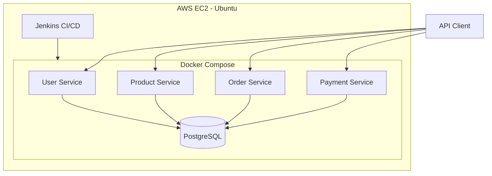

# ShopSphere — DevOps Microservices Platform

A hands-on DevOps portfolio project demonstrating a microservices-based e-commerce backend, containerization, automated testing, CI/CD, infrastructure management, deployment, metrics, and structured logging.

## 1. Project Overview

ShopSphere is a Python-based e-commerce backend built using four independent FastAPI microservices and PostgreSQL.

The application runs on AWS EC2 Ubuntu and uses Docker Compose to manage its containers.

### Key Features

- Four independent FastAPI microservices.
- PostgreSQL relational database.
- Docker and Docker Compose containerization.
- Automated API and integration testing using pytest.
- GitHub Actions continuous integration.
- Jenkins CI/CD and automated deployment.
- Terraform-based read-only AWS infrastructure inspection.
- Ansible server configuration and auditing.
- Prometheus-compatible application metrics.
- Structured JSON application logging.

## 2. Architecture



## 3. Microservices

The application consists of four independent FastAPI services.

| Service | Responsibility | Host Port |
|---|---|---:|
| User Service | User management | 8001 |
| Product Service | Product management | 8002 |
| Order Service | Order management | 8003 |
| Payment Service | Simulated payment operations | 8004 |
| PostgreSQL | Persistent database | 5432 |

Each application service runs in its own Docker container. Services communicate over Docker's internal network. Application API ports are bound to localhost on the EC2 host.

## 4. Technology Stack

| Category | Technology |
|---|---|
| Programming | Python, FastAPI |
| Database | PostgreSQL 16 |
| Testing | Pytest, Requests |
| Containers | Docker, Docker Compose |
| CI | GitHub Actions |
| CI/CD | Jenkins |
| Cloud | AWS EC2 |
| Infrastructure as Code | Terraform |
| Configuration Management | Ansible |
| Metrics | Prometheus Client |
| Logging | Python Logging, JSON |
| Version Control | Git, GitHub |
| Operating System | Ubuntu Linux |

## 5. Containerization

Docker Compose manages the application services and PostgreSQL database.

Useful commands:

```bash
# View running containers
docker compose ps

# Build and start services
docker compose up -d --build

# View recent logs
docker compose logs --tail=100

# Stop containers
docker compose down
```

The PostgreSQL database uses a persistent Docker volume. Avoid `docker compose down -v` unless you intentionally want to delete the database volume and its data.

## 6. CI/CD Pipeline

The project uses GitHub Actions and Jenkins.

### GitHub Actions

The GitHub Actions workflow:

1. Runs when code is pushed to GitHub.
2. Sets up the Python environment.
3. Starts the application and CI database.
4. Installs test dependencies.
5. Runs automated tests.
6. Reports success or failure.

### Jenkins

The Jenkins pipeline demonstrates:

1. Source code checkout.
2. Test dependency installation.
3. Automated test execution.
4. Connection to the EC2 host using a restricted SSH deployment key.
5. Application source code update.
6. Docker image builds.
7. Application container deployment.
8. Health verification of all four services.

### Deployment Safety

- Deployment uses a restricted SSH key and host-side script.
- Jenkins does not require direct access to the host Docker socket.
- The deployment script does not intentionally recreate PostgreSQL.
- Health checks verify the application services after deployment.
- Automatic rollback is not currently implemented.

## 7. Infrastructure Automation

### Terraform

Terraform inspects an existing AWS EC2 instance using a read-only data source.

The configuration reports:

- Instance ID
- Instance type
- Availability zone
- Instance state

The current configuration does not create or destroy AWS infrastructure.

### Ansible

Ansible demonstrates basic configuration management and server auditing.

Tasks include:

- Server connectivity validation.
- Installation of basic packages.
- Operating system information.
- CPU and memory information.
- Disk usage and uptime auditing.

## 8. Monitoring and Logging

### Health Checks

Each microservice exposes a `/health` endpoint to report service health and database connectivity.

### Application Metrics

Each microservice exposes a `/metrics` endpoint with Prometheus-compatible metrics, including:

- HTTP request counters.
- HTTP request duration histograms.

### Structured JSON Logging

Application request logs are emitted as structured JSON records containing information such as:

- Timestamp
- Service name
- HTTP method
- Request path
- Response status
- Request duration

Logs can be inspected using Docker Compose.

**Note:** Prometheus and Grafana servers are not currently deployed. The application exposes metrics for future integration with monitoring platforms.

## 9. Automated Testing

The project currently includes 13 automated tests.

| Test Category | Tests |
|---|---:|
| Service health checks | 4 |
| Invalid request validation | 4 |
| End-to-end integration flow | 1 |
| Metrics endpoint validation | 4 |
| **Total** | **13** |

Run the tests after starting the application:

```bash
source .venv/bin/activate
pytest -v
```

## 10. Repository Structure

```text
shopsphere-devops-platform/
├── .github/
│   └── workflows/
│       └── ci.yml
├── infrastructure/
│   ├── ansible/
│   ├── jenkins/
│   └── terraform/
├── services/
│   ├── user-service/
│   ├── product-service/
│   ├── order-service/
│   └── payment-service/
├── shared/
│   ├── metrics.py
│   └── logging_config.py
├── tests/
├── docker-compose.yml
├── Jenkinsfile
├── requirements-dev.txt
└── README.md
```

## 11. Security and Limitations

- Payment operations are simulated; no real financial transactions occur.
- Terraform currently performs read-only infrastructure inspection.
- Prometheus and Grafana servers are not deployed.
- Automatic deployment rollback is not implemented.
- Application API ports are bound to localhost on the EC2 host.
- Environment files, passwords, tokens, and private keys must never be committed.
- Terraform state and sensitive variable files must remain excluded from version control.
- This is a learning and portfolio project, not a fully production-hardened platform.

## 12. Future Improvements

- Deploy Prometheus and Grafana.
- Implement automated deployment rollback.
- Expand automated test coverage.
- Improve authentication and application security.
- Explore Kubernetes-based deployment.
- Extend infrastructure automation.

## 13. Repository

GitHub: https://github.com/ahmad24mliwala/shopsphere-devops-platform
